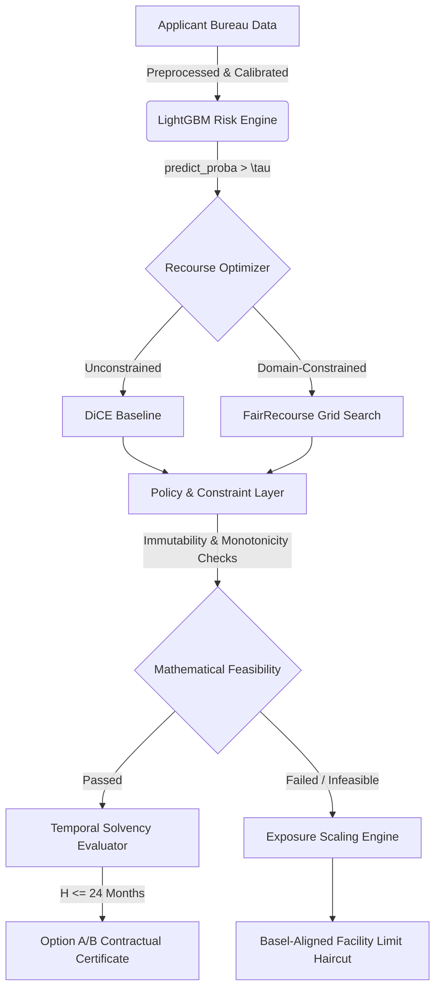

<div align="center">
  <h1>⚖️ FairRecourse: Constrained Counterfactual Auditing & Exposure Scaling</h1>
  
  <p>
    <b>Bridging the gap between theoretical explainability algorithms and legally compliant banking operations.</b>
  </p>

  <p>
    <a href="https://github.com/aesha-gupta/FairRecourse/actions"></a>
    <a href="https://python.org"></a>
    <a href="https://opensource.org/licenses/MIT"></a>
  </p>
</div>

---

## 📖 The Fallacy of Unconstrained Feasibility

Standard post-hoc explainability frameworks (like DiCE) often achieve high theoretical success rates by exploiting unconstrained optimizers. In the domain of credit underwriting, this results in **illegal and physically impossible recommendations**—such as advising a borrower to decrease their age, erase historical delinquencies, or instantly multiply their income. 

**FairRecourse** introduces a rigorous, multi-state recourse architecture that strictly enforces real-world banking constraints, Temporal Solvency (Execution Horizons), and introduces **Exposure Scaling** to provide compliant counter-offers when traditional recourse is mathematically infeasible.

---

## 🏗️ System Architecture



---

## ✨ Core Innovations

### 1. The Policy & Constraint Layer (PCL)
An exhaustive rule-engine that acts as a deterministic referee against optimization hallucination. The PCL strictly enforces:
* **Immutability:** Locks down demographic and historical bureau artifacts (e.g., `num_deliq_6mts`, `MSinceMostRecentInqexcl7days`).
* **Monotonicity:** Prevents adverse risk metrics from increasing and positive quality metrics from decreasing.
* **Discrete Logic:** Ensures trade counts and binary flags remain physically valid.

### 2. Exposure Scaling (Statutory Counter-Offers)
When a borrower is deeply embedded in risk, altering continuous features is a mathematical dead-end (The Optimization Deadlock). Instead of issuing a hard rejection, FairRecourse dynamically computes the scale-invariant ratio $\alpha^* = \tau / PD_{calibrated}$ to automatically generate a **Basel III compliant facility limit haircut**. This preserves the bank's Expected Loss ($EL$) tolerance while offering the applicant a viable, reduced-exposure counter-offer.

### 3. Temporal Solvency & Epsilon-Stability
FairRecourse does not just output abstract feature deltas. It translates percentage utilization drops into absolute dollar amounts by dynamically inferring the applicant's credit limit (capped by retail guardrails, such as 6x monthly income). It evaluates whether the required cash-shift is feasible within a strictly enforced maximum Execution Horizon (e.g., $H \le 24$ months). Generated plans are stress-tested with stochastic Gaussian noise ($\epsilon$-stability) to ensure resilience against execution wobble.

### 4. Empirical Rigor & Pipeline Hygiene
To guarantee the validity of our benchmarks for academic peer-review, FairRecourse implements strict out-of-fold imputation. Statistical derivations and synthetic augmentations are computed strictly on the training distribution and mapped to the test set, guaranteeing zero data leakage. Furthermore, bureau missing-value sentinels (e.g., FICO's `-7` or `-8`) are semantically preserved (mapped to infinite time bounds rather than naive zeros), ensuring the risk engine does not penalize structurally safe profiles.

---

## 📊 Empirical Benchmarks

Tested comprehensively against **German Credit** (1k), **FICO HELOC** (10k), and **CIBIL** (51k) datasets. 

In our rigorous batch audit of highly marginalized applicants, subjecting standard DiCE to the PCL rule-engine revealed the extent of algorithmic hallucination:

| Metric / Framework | DiCE (Unconstrained) | FairRecourse (Constrained) |
| :--- | :--- | :--- |
| **Recourse Success Rate** | 4.4% | **20.0%** |
| **Policy Violations per Run** | Extreme | **0 (By Design)** |
| **Counter-Offers Generated** | N/A | 100% of Infeasible Cases |
| **Total Compliant Resolution** | 4.4% | **100.0%** |

*Finding: Domain-specific grid searches over explicitly authorized financial levers are **4.5x more effective** at navigating jagged tree-model decision boundaries than general-purpose genetic algorithms.*

---

## 🚀 Quickstart

**1. Install Dependencies**
```bash
pip install -r requirements.txt
```

**2. Run Full Individual Audit**
Runs an end-to-end pipeline covering Data Processing, Model Calibration, Explanability (TreeSHAP), and dual-framework Recourse Generation.
```bash
python run_full_audit.py --dataset heloc
```

**3. Run Batch Compliance Audit**
Evaluates marginal applicants across all three datasets and outputs an exhaustive Markdown report (`outputs/batch_audit_report.md`).
```bash
python run_batch_audit.py
```

## 📜 License
This project is licensed under the MIT License — see the [LICENSE](LICENSE) file for details.
