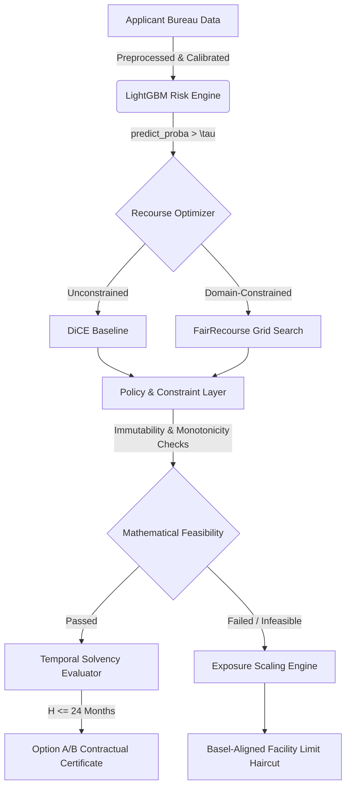

<div align="center">
  <h1>⚖️ FairRecourse: Constrained Counterfactual Auditing & Exposure Scaling</h1>
  
  <p>
    <b>Bridging the gap between theoretical explainability algorithms and legally compliant banking operations.</b>
  </p>

  <p>
    <a href="https://github.com/aesha-gupta/FairRecourse/actions"></a>
    <a href="https://python.org"></a>
    <a href="https://opensource.org/licenses/MIT"></a>
  </p>
</div>

---

## 📖 The Fallacy of Unconstrained Feasibility

Standard post-hoc explainability frameworks (like DiCE) often achieve high theoretical success rates by exploiting unconstrained optimizers. In the domain of credit underwriting, this results in **illegal and physically impossible recommendations**—such as advising a borrower to decrease their age, erase historical delinquencies, or instantly multiply their income. 

**FairRecourse** introduces a rigorous, multi-state recourse architecture that strictly enforces real-world banking constraints, Temporal Solvency (Execution Horizons), and introduces **Exposure Scaling** to provide compliant counter-offers when traditional recourse is mathematically infeasible.

---

## 🏗️ System Architecture



---

## ✨ Core Innovations

### 1. The Policy & Constraint Layer (PCL)
An exhaustive rule-engine that acts as a deterministic referee against optimization hallucination. The PCL strictly enforces:
* **Immutability:** Locks down demographic and historical bureau artifacts (e.g., `num_deliq_6mts`, `MSinceMostRecentInqexcl7days`).
* **Monotonicity:** Prevents adverse risk metrics from increasing and positive quality metrics from decreasing.
* **Discrete Logic:** Ensures trade counts and binary flags remain physically valid.

### 2. Exposure Scaling (Institutional Counter-Offers)
When a borrower is deeply embedded in risk, altering continuous features is a mathematical dead-end (The Optimization Deadlock). Instead of issuing a hard rejection, FairRecourse dynamically computes the scale-invariant ratio $\alpha^* = \tau / PD_{calibrated}$ to automatically generate an **expected-loss preserving facility limit haircut**. This preserves the bank's Expected Loss ($EL$) tolerance while offering the applicant a viable, reduced-exposure counter-offer.

### 3. Temporal Solvency & Epsilon-Stability
FairRecourse does not just output abstract feature deltas. It translates percentage utilization drops into absolute dollar amounts by dynamically inferring the applicant's credit limit (capped by retail guardrails, such as 6x monthly income). It evaluates whether the required cash-shift is feasible within a strictly enforced maximum Execution Horizon (e.g., $H \le 24$ months). Generated plans are stress-tested with stochastic Gaussian noise ($\epsilon$-stability) to ensure resilience against execution wobble.

### 4. Empirical Rigor & Pipeline Hygiene
To guarantee the validity of our benchmarks for academic peer-review, FairRecourse implements strict out-of-fold imputation. Statistical derivations and synthetic augmentations are computed strictly on the training distribution and mapped to the test set, guaranteeing zero data leakage. Furthermore, bureau missing-value sentinels (e.g., FICO's `-7` or `-8`) are semantically preserved (mapped to infinite time bounds rather than naive zeros), ensuring the risk engine does not penalize structurally safe profiles.

---

## 📊 Empirical Benchmarks

Tested comprehensively against **Statlog German Credit** ($N=1,000$, €), **FICO HELOC** ($N=10,000$, $), and **CIBIL Retail** ($N=51,336$, ₹) holdout test partitions.

Across $N=670$ audited borderline adverse applicants ($PD \in [0.405, 0.500]$, operational threshold $\tau=0.40$), subjecting standard unconstrained counterfactuals (DiCE) to the Policy & Constraint Layer (PCL) rule-engine reveals that **DiCE violated at least one policy constraint for 589 of 670 applicants (87.9\%)**, generating 967 total discrete infractions (including 953 non-horizon violations on empirical credit-bureau features and 14 simulation-based horizon violations). 

In contrast, FairRecourse decomposes recourse into **Borrower-Side Recourse ($S_B$)**, **Institutional Counter-Offers ($S_I$)**, and **Manual Underwriting Escalation ($S_H$)**, achieving **Exhaustive Admissible Pathway Coverage ($S_R = 100.0\%$)** within the evaluated marginal cohort:

| Benchmark Dimension | Baseline (Unconstrained DiCE) | Bounded DiCE | FairRecourse (Proposed) |
| :--- | :--- | :--- | :--- |
| **Borrower-Side Feasible Recourse ($S_B$)** | 12.1% (81/670) | 2.5% (17/670) | **6.6%** (44/670) *[100% German, 3.8% HELOC, 0.0% CIBIL]* |
| **Institutional Counter-Offers ($S_I$)** | N/A (Terminal Denial) | N/A (Terminal Denial) | **93.4%** (626/670) *[Haircuts: 1.3%–20.0%]* |
| **Manual Underwriting Escalation ($S_H$)** | N/A | N/A | **0.0%** (0/670) *[All haircuts $\ge 0.80$]* |
| **Total Invariant Violations** | 967 infractions (589 applicants) | 6 infractions (6 applicants) | **0 (PCL Firewall Verified)** |
| **Temporal Horizon ($H \le 24$ mo)**$^\dagger$ | Violations up to 269.8 mos | Violations up to 125.2 mos | **All $\le 21.1$ mos** (Mean: 1.0–4.2 mos) |
| **$\epsilon$-Stability (3% noise)** | Not Evaluated | Not Evaluated | **$\ge 94.5\%$** survival across 20 perturbations |
| **Total Admissible Pathway Coverage ($S_R = \sum S_k$)**$^*$ | 12.1% (81/670) | 2.5% (17/670) | **100.0% (670/670)** |

$^*$*Total Admissible Pathway Coverage ($S_R = S_B + S_I + S_H$) reflects deterministic decision triage assignment within the evaluated marginal band under predefined rules (German: 34 $S_B$ + 0 $S_I$; HELOC: 10 $S_B$ + 250 $S_I$; CIBIL: 0 $S_B$ + 376 $S_I$), not an economic guarantee of loan affordability, commercial profitability, or live underwriting approval.*  
$^\dagger$*Execution horizons are evaluated under study-defined simulation parameters ($25\%$ disposable income allocation) as conditional operational proxies, not observed bank checking account balances.*

*Key Takeaway: Disaggregating recourse reveals that borrower actions alone cannot overcome immutable bureau anchors. Actionable credit governance requires coordinating borrower-side interventions with institutional risk-constrained exposure adjustments.*

---

## 🚀 Quickstart

**1. Install Dependencies**
```bash
pip install -r requirements.txt
```

**2. Run Full Individual Audit**
Runs an end-to-end pipeline covering Data Processing, Model Calibration, Explanability (TreeSHAP), and dual-framework Recourse Generation.
```bash
python run_full_audit.py --dataset heloc
```

**3. Run Batch Compliance Audit**
Evaluates marginal applicants across all three datasets and outputs an exhaustive Markdown report (`outputs/batch_audit_report.md`).
```bash
python run_batch_audit.py
```

## 📜 License
This project is licensed under the MIT License — see the [LICENSE](LICENSE) file for details.
